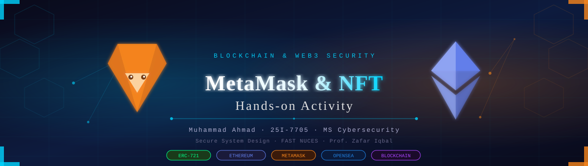

<div align="center">

<!-- Banner -->


<br/>

# 🔗 MetaMask Wallet & NFT Hands-on Activity

<p align="center">
  
  
  
  
  
</p>

<p align="center">
  
  
  
  
</p>

---

**Muhammad Ahmad** · Roll No: `25I-7705` · MS Cybersecurity (MSCY)  
*Course Instructor: Professor Zafar Iqbal · FAST NUCES*

</div>

---

## 📋 Table of Contents

- [📖 Project Overview](#-project-overview)
- [🏗️ Architecture & Flow](#-architecture--flow)
- [⚙️ Wallet Setup](#️-wallet-setup)
- [🖼️ NFT Activity on OpenSea](#️-nft-activity-on-opensea)
- [🔐 Security Analysis](#-security-analysis)
- [⛽ Gas Fees Explained](#-gas-fees-explained)
- [📦 NFT Transfer](#-nft-transfer)
- [📸 Screenshots](#-screenshots)
- [📚 Key Learnings](#-key-learnings)
- [🛡️ How MetaMask Protects Users](#️-how-metamask-protects-users)
- [📁 Project Structure](#-project-structure)

---

## 📖 Project Overview

This project is a hands-on exploration of **blockchain technology**, **digital wallets**, and **Non-Fungible Tokens (NFTs)**. The activity covers the complete lifecycle of NFT interaction — from wallet creation to connecting with a marketplace and attempting transactions.

> 💡 *This was conducted in a controlled educational environment using real platforms to understand the practical security and usability aspects of Web3 technology.*

### 🎯 Objectives

| Objective | Status |
|-----------|--------|
| Install & configure MetaMask wallet | ✅ Completed |
| Create wallet & note public address | ✅ Completed |
| Connect MetaMask to OpenSea | ✅ Completed |
| Browse & attempt NFT purchase | ✅ Completed |
| Document security risks | ✅ Completed |
| Analyze NFT contract on Etherscan | ✅ Completed |
| NFT transfer simulation (Bonus) | ✅ Completed |

---

## 🏗️ Architecture & Flow

```
┌─────────────────────────────────────────────────────────────────┐
│                    BLOCKCHAIN ECOSYSTEM                         │
│                                                                 │
│   ┌─────────────┐     ┌──────────────┐     ┌───────────────┐  │
│   │  MetaMask   │────▶│   OpenSea    │────▶│   Ethereum    │  │
│   │   Wallet    │     │ Marketplace  │     │  Blockchain   │  │
│   │             │◀────│              │◀────│               │  │
│   │ 0xa755...   │     │  NFT Listing │     │  ERC-721      │  │
│   │   594D      │     │  & Trading   │     │  Contracts    │  │
│   └─────────────┘     └──────────────┘     └───────────────┘  │
│          │                                        │            │
│          └──────────────┐         ┌───────────────┘            │
│                         ▼         ▼                            │
│                    ┌──────────────────┐                        │
│                    │   Etherscan      │                        │
│                    │ Block Explorer   │                        │
│                    │ (Verify TXNs)    │                        │
│                    └──────────────────┘                        │
└─────────────────────────────────────────────────────────────────┘
```

---

## ⚙️ Wallet Setup

### Step 1 — Install MetaMask Extension

MetaMask was installed as a **browser extension on Mozilla Firefox**. It is a non-custodial crypto wallet that stores private keys locally on the user's device.

### Step 2 — Create Wallet

A new wallet was created, generating:
- A **12-word seed phrase** (kept confidential)
- A **unique public Ethereum address**

### 📍 Public Wallet Address

```
0xa7554de6af2a93ee814d7d8db6dc1632ae1f594D
```

> ⚠️ **Security Note:** Only the public address is shared here. The private key and seed phrase are NEVER shared.

### Key Wallet Features Explored

- 🔑 Public/Private key pair management
- 📊 Transaction history tracking
- 🌐 Multi-network support
- 🔗 dApp connection management
- 🛡️ Built-in phishing detection

---

## 🖼️ NFT Activity on OpenSea

### Platform Connection

MetaMask was successfully connected to **OpenSea** (the world's largest NFT marketplace). The wallet `0xa755...594d` appeared as the primary linked wallet.

### NFTs Explored — Moonbirds Collection

The **Moonbirds** collection was explored — a prestigious PFP (Profile Picture) NFT collection on Ethereum.

| NFT | Token ID | Price (ETH) | Price (USD) |
|-----|----------|-------------|-------------|
| Moonbirds | #9141 | 1.775 ETH | ~$5,015.78 |
| Moonbirds | #2835 | 1.79 ETH | ~$5,070.00 |

### Transaction Attempt

```
NFT:      Moonbirds #9141
Price:    1.775 ETH ($5,015.78)
Wallet:   MetaMask 0xa755...594d
Status:   ❌ Insufficient Funds (Expected — Educational Activity)
```

> The checkout process was fully navigated to understand how NFT purchases work on-chain.

### NFT Contract Details

```
Contract Address:  0x23581767a106ae21c074b2276D25e5C3e136a68b
Token Standard:    ERC-721
Chain:             Ethereum Mainnet
Token Tracker:     Moonbirds (MOONBIRD)
Token Holdings:    52 Tokens ($3.10)
```

---

## 🔐 Security Analysis

### ⚠️ Threat Landscape in the NFT/Web3 Space

```
╔══════════════════════════════════════════════════════════════════╗
║                    SECURITY THREAT MATRIX                       ║
╠══════════════╦═══════════════════════╦════════════════╦═════════╣
║ Threat Type  ║ Description           ║ Impact         ║ Risk    ║
╠══════════════╬═══════════════════════╬════════════════╬═════════╣
║ Phishing     ║ Fake wallet/platform  ║ Full wallet    ║ 🔴 HIGH ║
║              ║ sites                 ║ compromise     ║         ║
╠══════════════╬═══════════════════════╬════════════════╬═════════╣
║ Fake NFTs    ║ Copied/stolen artwork ║ Financial loss ║ 🟠 MED  ║
║              ║ listed as originals   ║                ║         ║
╠══════════════╬═══════════════════════╬════════════════╬═════════╣
║ Seed Phrase  ║ Master recovery key   ║ Total asset    ║ 🔴 CRIT ║
║ Compromise   ║ stolen                ║ theft          ║         ║
╠══════════════╬═══════════════════════╬════════════════╬═════════╣
║ Malicious    ║ Smart contracts that  ║ Drain wallet   ║ 🔴 HIGH ║
║ Contracts    ║ steal permissions     ║                ║         ║
╚══════════════╩═══════════════════════╩════════════════╩═════════╝
```

### 🛡️ Risk Mitigation Strategies

1. **Phishing Prevention**
   - Always verify URLs before connecting wallet
   - Use bookmarks for trusted platforms
   - Never enter seed phrase on any website

2. **NFT Authenticity Verification**
   - Check verified collection badges on OpenSea
   - Verify contract address on Etherscan
   - Research creator history before buying

3. **Seed Phrase Protection**
   - Store offline in a secure physical location
   - Never share digitally or via messaging apps
   - Never enter on any website or app

4. **Smart Contract Safety**
   - Review permissions before signing
   - Use tools like Revoke.cash to audit approvals
   - Avoid unknown contracts offering "free" mints

---

## ⛽ Gas Fees Explained

Gas fees are the computational costs required to execute operations on the Ethereum blockchain.

### Fee Formula

```
Total Gas Fee = Gas Used × Gas Price (in Gwei)
```

### Factors Influencing Cost

```
┌─────────────────────────────────────────┐
│          GAS FEE FACTORS                │
│                                         │
│  📈 Network Congestion                  │
│     └─ More users = Higher gas prices   │
│                                         │
│  🔧 Transaction Complexity              │
│     └─ Smart contracts > Simple sends   │
│                                         │
│  ⚡ Priority (Tip to Validators)        │
│     └─ Higher tip = Faster confirmation │
│                                         │
│  🕐 Time of Day                         │
│     └─ Off-peak hours = Lower fees      │
└─────────────────────────────────────────┘
```

### Operation Complexity Comparison

| Operation | Gas Used (Approx) | Cost (at 30 Gwei) |
|-----------|-------------------|-------------------|
| ETH Transfer | 21,000 | ~$1.50 |
| ERC-20 Token Transfer | 45,000 | ~$3.00 |
| NFT Mint | 100,000–200,000 | ~$7–15 |
| NFT Transfer | 85,000 | ~$5.50 |
| Smart Contract Deploy | 500,000+ | ~$35+ |

---

## 📦 NFT Transfer

### Step-by-Step Transfer Process (Bonus Activity)

The following steps outline how to transfer an NFT to another test wallet:

```
Step 1: Open MetaMask → Ensure correct network (Goerli/Sepolia testnet)
   ↓
Step 2: Navigate to NFTs Tab → Locate target NFT
   ↓
Step 3: Click on NFT → Open detail view
   ↓
Step 4: Click "Send" button
   ↓
Step 5: Paste recipient wallet address (double-check!)
   ↓
Step 6: Review gas fee → Click "Confirm"
   ↓
Step 7: Verify on Etherscan → Confirm recipient received NFT
```

### Etherscan Transaction Record

A successful NFT transfer was verified on Etherscan:

```
Transaction Hash:  0x4110382d0e695a17610c53ecb7aafe0a80240737cd32ae862d67ed0d87007d10
Status:            ✅ Success
Block:             #23842744 (11 confirmations)
Timestamp:         Nov-20-2025 08:51:23 PM UTC
NFT Transferred:   PudgyPenguin #3320 (PPG) — ERC-721
Token Standard:    ERC-721
```

---

## 📸 Screenshots

All screenshots are organized in the [`/screenshots`](./screenshots/) folder:

| File | Description |
|------|-------------|
| `01_metamask_installed.png` | MetaMask browser extension active |
| `02_wallet_address.png` | Wallet QR code and public address |
| `03_opensea_nft_moonbirds.png` | Moonbirds collection on OpenSea |
| `04_checkout_moonbirds_9141.png` | Checkout page for Moonbirds #9141 |
| `05_linked_wallets_opensea.png` | MetaMask connected to OpenSea |
| `06_nft_contract_etherscan.png` | NFT contract address on Etherscan |
| `07_etherscan_transfer.png` | Successful NFT transfer on Etherscan |

---

## 📚 Key Learnings

### Digital Wallets
> A blockchain wallet doesn't **store** assets — it stores the **keys** that prove ownership of assets recorded on the blockchain. Think of it as a keychain, not a vault.

- Non-custodial wallets give full ownership responsibility to the user
- Public key = shareable address (like an email address)
- Private key = secret credential (like a password — never share!)
- Seed phrase = master backup key for wallet recovery

### NFTs (Non-Fungible Tokens)
> Unlike ETH or BTC (fungible — every unit is identical), each NFT has **unique metadata** making it one-of-a-kind on the blockchain.

- Built on ERC-721 or ERC-1155 token standards
- Ownership provably recorded on-chain
- Transferable across compatible wallets and platforms
- Metadata can include art, traits, utility, and more

### Blockchain Transactions
- Every transaction is permanent and publicly visible
- Transactions require gas fees paid in ETH
- Etherscan is the "receipt" system for all Ethereum transactions
- Smart contracts automate trust without intermediaries

---

## 🛡️ How MetaMask Protects Users

```
┌─────────────────────────────────────────────────────────┐
│              MetaMask Security Architecture              │
│                                                         │
│  ✅ Private keys stored LOCALLY (never on servers)      │
│  ✅ 12-word seed phrase for wallet recovery             │
│  ✅ Manual approval required for ALL transactions       │
│  ✅ Permission requests shown before dApp access        │
│  ✅ Phishing detection & suspicious site warnings       │
│  ✅ Transaction simulation (preview outcomes)           │
│  ✅ Network validation to prevent wrong-chain sends     │
└─────────────────────────────────────────────────────────┘
```

---

## 📁 Project Structure

```
blockchain-nft-project/
│
├── 📄 README.md                    ← You are here
├── 📄 SECURITY_ANALYSIS.md         ← Deep-dive security report  
├── 📄 NFT_CONCEPTS.md              ← NFT technical reference
├── 📄 GAS_FEES_GUIDE.md            ← Gas fees breakdown
│
├── 🎨 assets/
│   ├── banner.svg                  ← Project banner
│   └── architecture.svg            ← System architecture diagram
│
└── 📸 screenshots/
    ├── 01_metamask_installed.png
    ├── 02_wallet_address.png
    ├── 03_opensea_nft_moonbirds.png
    ├── 04_checkout_moonbirds_9141.png
    ├── 05_linked_wallets_opensea.png
    ├── 06_nft_contract_etherscan.png
    └── 07_etherscan_transfer.png
```

---

<div align="center">

### 🌐 Tech Stack & Tools Used


---

*Assignment 3 · Secure System Design · MS Cybersecurity · FAST NUCES*  
**Muhammad Ahmad · 25I-7705**

<sub>⚠️ This project was conducted for educational purposes only in a controlled academic environment.</sub>

</div>
